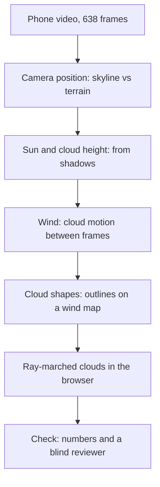

<video src="/assets/video/blog/tehran-clouds-sky.mp4" poster="/assets/img/blog/tehran-clouds/sky-poster.jpg" autoplay muted loop playsinline></video>

*The simulation, sky only. Each cloud here sits where the real one sat, at the same moment of the clip.*

## A tweet and one message

Hadi Nikkhah posted [a time-lapse of the sky over Tehran](https://x.com/hadinik/status/2120201605970821199): 21 seconds of puffy clouds drifting over the city, with the snowy Alborz mountains behind. Their shadows slide across the slopes.

I sent the link to an AI coding agent (Claude Fable 5.2, running in Claude Code on my home PC) with one message:

> I want the most accurate 3D simulation you can build of these moving clouds, so close that nobody can tell the real one from the simulated one. Watch the motion carefully, frame by frame: the different layers, the puffy clouds and the flatter ones, their shadows on the mountains. Show me your power like crazy.

## Not look-alike clouds

The easy version of this task is a nice cloud shader with clouds that look roughly like Tehran. That is not what the agent built. It treated the video as a measurement and worked backwards from it:

- **Where the phone stood.** It matched the mountain skyline in the video against real elevation data of the Alborz. That gave the camera's position in west Tehran, where it pointed and its lens, to within about 2.4 pixels. It also found that the phone slid about 5 pixels in the first seven seconds and corrected every frame for it.
- **The sun and the clock.** A cloud's shadow on a slope lies on the line towards the sun. So the agent searched for the sun direction and cloud height that make the dark patches on the slopes line up with the clouds above them. It did this twice: once from the shadows alone, and once from the sun's path over Tehran on the day the video was posted. The two answers were less than 5 degrees apart. The shadows also gave away the clock: each frame is about 4 seconds, so the 21-second clip covers about 42 minutes of a late morning, and the sun moves 10.6 degrees while it runs.
- **Wind.** The motion between frames showed two layers: the puffy cumulus moving away to the right, and a thin high layer drifting faster in a slightly different direction.
- **Cloud shapes.** Every second frame was projected back onto the height of the cloud bases, on a map that moves with the wind. That gives each cloud's outline as the camera saw it. Each cloud is then a heap with a flat base, as large as fits inside that outline. Clouds behind the camera never appear in the frame, but their shadows do, so those were rebuilt from the shadows.
- **Thin clouds.** The thin veil and the high layer were separated by how they move: each one stays still on its own wind map, while the other passes through.

The result runs in a web page. The clouds are ray-marched volumes in WebGL2, with several layers of noise for the detail, from lobes a kilometre wide down to frayed edges of a few tens of metres. Sunlight is traced through the cloud, and the same volume casts the shadows on the mountains. The live page plays it in real time on my PC, at about 25 frames per second with a lower cloud resolution. The full-quality video takes about 27 minutes to render.

So what is real and what is made up? From the video: the camera, the wind, the time of day, the height of the clouds, and the place, outline and thickness of every cloud that entered the frame. From survey data: the terrain. Invented: the small texture of the clouds, the tops of clouds the camera never saw, and the light on the ground between its measured sunny and shaded colours.

## Four rounds

The first version was ready 2 hours and 42 minutes after my message. The clouds were in the right places, and 73% of the simulated cloud area lay on top of the real clouds. But side by side, you could tell at once which one was real. The agent said so itself, listed the differences, and offered "a next step".

In the morning I wrote back what bothered me: the clouds were too thick and too smooth; the light direction was wrong, although the date and place were known and the sun's path can be computed; the buildings had no detail; the flag didn't match; and in some frames the clouds changed shape suddenly to catch up with the real ones. I also asked whether it was using the best methods, because I have seen real-time clouds in games with more detail than this.

That round found the biggest mistake. The sun direction had been almost right all along. The cloud height was wrong: the first guess was 4,750 metres, and the shadows say about 3,600. With the wrong height, every shadow landed in the wrong place. The agent fixed it, smoothed the changes in cloud shape over time, and added a delivery check: a script that compares the render with the video point by point.

The new render passed all 26 lines of the check. It still looked fake. The undersides of the clouds were too flat, the border between lit and shaded parts was too sharp, and the buildings were plain boxes. My answer:

> You talk about a next step, while I asked for every detail, not a part of it to finish later. I expect the next step to be the last one, and you to use everything you have for the highest accuracy.

The third round was the longest, about five hours instead of the promised three to four. The agent rebuilt the clouds with ragged rims and long wisps, took the colours of the mountains and the city straight from the video, matched the sky colour and its slow change through the clip, and fixed the edge of the ground around a lattice mast. It also stopped trusting its own eyes. Before each delivery, a separate reviewer that did not build the render got pairs of real and simulated frames, in random order, and had to name the fake in each pair.

In the evening I watched it and wrote:

> The output as a whole is good enough. The only thing I want fixed is the cloud shadows on the buildings. They are so sharp that their motion feels like flickering. They should be very, very soft. Softer than the clouds themselves.

The cause was simple. A cloud moves about 35 metres between two frames, and a sharp shadow edge made the buildings blink. The fix was to blur the shadow over 160 metres before it touches the ground. The frame-to-frame flicker on the city went from 3.5 times the real video's to about a quarter of it. That was the last change.

## What it got wrong

The measurements impressed me more than the rendering. Finding a camera from a skyline, and a time of day from cloud shadows, is careful detective work. The mistakes were mostly not technical:

- **It called the work done while it could see the differences.** Twice it delivered a version, listed what still gave it away, and offered another round. I had asked for one finished result, not a series of drafts.
- **Passing numbers are not the same as looking right.** The check went from 19 lines to 36, and a render could pass all of them and still look fake to anyone. The blind reviewer was the more honest test.
- **Blind reviewers have habits too.** Once the reviewer scored 15 of 24, close to a coin flip. Then the agent noticed it had picked the lower image in 22 of the 24 pairs, whichever was real. The score meant nothing. In the last look a reviewer named the simulation in all 24 pairs again, by a faint ghost of the flag, evenly lit mountains and a smoother sky.
- **It asked me a question it should have answered itself.** "Should I take the colours of the mountains and buildings from the video?" That is a choice of method, not a matter of taste. My answer: "This wasn't a question for me. Take them from the video."
- **It froze my PC.** The renders run in a hidden browser on the graphics card. The first full render took about 95% of the GPU, and the whole computer slowed down. I had to open another session just to find out why. At the end I wrote: "If it doesn't go well, don't start the render again. The system slows down and I want to play."

## What it cost

| | |
|---|---|
| From my message to the last video | about 21 hours |
| Time the agents actually worked | about 11 hours, in six sessions |
| My messages | eight, four of them real feedback |
| Model calls | 739 (625 of them to Fable 5.2) |
| Tokens read | about 235 million, 98% of them re-read from the cache |
| Tokens written | about 1.65 million |
| Price at API rates, main model only | about $157 |

Each session has a memory limit. When a conversation got too long, the agent wrote a handover note and started a fresh session that continued from it. That happened five times. Most of the tokens are the agent re-reading its own conversation at every step, which is cheap per token but adds up. I paid with my subscription, not per token. By the afternoon of the second day, my week's allowance for Fable was down to 1%, so the last reviews and the shadow fix ran on Claude Opus 5.5.

The first version alone took 2 hours and 42 minutes, 64 million tokens read and 470 thousand written: about $45 at API rates.

## Where it ended

It is not indistinguishable. If you put the two side by side and look for a while, you can find the simulation. But the clouds are the real clouds, in the real places, under the real sun, and the big things a viewer feels, the motion and the light, are right.

What stays with me is the split of work. The agent was strong at the parts I would find slow: measuring, solving, writing the renderer, checking frames by the hundred. It was weak at the part that only takes a glance: knowing when something looks wrong and not handing it over. That glance was my job. Next time I would give the agent the blind reviewer and the "show me only when it passes" rule from the first message, instead of adding them after two rounds.

*Original time-lapse by [Hadi Nikkhah](https://x.com/hadinik). Elevation data: Mapzen / AWS Terrain Tiles (SRTM-derived, open data).*
